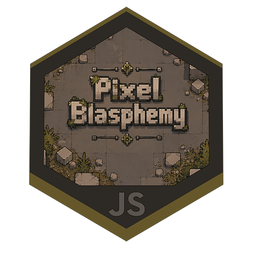

<div align="center"><pre>P I X E L   B L A S P H E M Y</pre>

Retro Pixel Art Snapper & Mastering Studio

<p align="center">
    
</p>

# [LAUNCH STUDIO](https://avgerinos8.github.io/pixel-blasphemy/)

**Live Web Application:**  
### [https://avgerinos8.github.io/pixel-blasphemy/](https://avgerinos8.github.io/pixel-blasphemy/)

*Zero installation. Runs 100% client-side in any modern browser.*

</div>

---

## Overview

PixelBlasphemy converts AI-generated concept art (Gemini / Nano-Banana, ComfyUI, Midjourney) into grid-aligned, palette-quantized retro pixel art assets. It eliminates mixels, sub-pixel blur, and palette pollution.

The entire processing pipeline runs client-side in the browser via Canvas 2D and WebAssembly, with optional local Node.js or Python acceleration.

---

## Core Capabilities

- **Dual Engine Pipeline**:
  - **Pixel Snapper**: Sprite Fusion grid-snapping algorithm with integer downsampling (`/2`, `/4`, `/8`, `/16`, `1x`).
  - **Unfake Engine**: Multi-scale analysis combining autocorrelation, runs-based detection, and morphological cleanup.
- **HITL Asset Studio & Extractor (New Public Tab)**:
  - Interactive Human-In-The-Loop canvas studio for extracting props, tiles, and character sprites directly from concept art.
  - Interactive bounding boxes with 8-point resize handles, Shift key ratio locking (1:1 square & corner aspect lock), spatial movement, and quick clone (`+ Same Size`, hotkey `S`).
  - Streets of Regex naming rules (`${scale}x_${opaque ? 'opaque_' : ''}${name}.png`) with predicted native super-resolution preview.
  - One-click **"Send to Pixel Snapper"** bridge: immediately pipes any extracted or upscaled asset straight into the Snapper Studio for grid snapping, palette quantization, and retro export.
- **Super-Resolution Upscaling (Toggleable Local Hardware / In-Browser)**:
  - **Local PC Hardware Acceleration (Real-ESRGAN Vulkan GPU)**:
    - Dedicated local GPU super-resolution pipeline with multi-pass chaining (`2x`, `4x`, `6x`, `8x`, `12x`, `16x`, `24x`, `32x`, `48x`).
    - Conditional background isolation: automatically applies `rembg birefnet-general` alpha matting and ImageMagick/Pillow trimming unless marked `Opaque`.
    - `Opaque` flag skips background removal to preserve textures, solid walls, and floor tiles.
  - **Client-Side In-Memory Engine**:
    - Toggleable switch in the UI: turn off local hardware resources (or run offline/statically on GitHub Pages) for instantaneous client-side in-browser canvas upscaling.
- **Smart Outline Healer**:
  - High-res ridge / skeleton tracing restores broken contours and thin 1px silhouettes without pixel clumping.
- **Palette Architecture**:
  - K-Means color quantization with locked palette protection.
  - Interactive eyedropper color sampler with real-time magnification loupe.
  - Reference image color extractor.
  - Same Palette batch locking across all queued images.
  - Full GIMP GPL palette and JSON preset import/export.
- **Pre-Palette Curve Adjustments**:
  - Monotone cubic spline tone mapping curves, brightness, contrast, saturation, and black/white point clipping.
- **Retro Export**:
  - True 8-bit indexed-color PNG export (`PLTE` and `tRNS` chunks) with hard 1-bit or multi-level alpha.
  - Optional 1px arcade outline generation.

---

## How to Run

### 1. Online (Zero Install)
Open [https://avgerinos8.github.io/pixel-blasphemy/](https://avgerinos8.github.io/pixel-blasphemy/) directly. Works on any desktop, tablet, or mobile browser.

### 2. Windows One-Click (`Launch-PixelBlasphemy.bat`)
Double-click `Launch-PixelBlasphemy.bat` in the repository root.
- Detects Node.js and starts the full studio server.
- Falls back to Python's static server if Node is missing.
- Falls back to native Windows PowerShell HTTP server if neither Node nor Python is installed (zero dependencies).
- Automatically opens the default browser at `http://localhost:8080/`.

### 3. Local Node.js Server
```bash
npm start
# or: node server.js 8080
```
Runs the local server and enables saving palettes and options directly to `./temp/saved/`.

### 4. Static Dev Server
```bash
npx serve app -l 8080
```

### 5. Standalone Python CLI Tool
For automated or headless batch processing:
```bash
python tools/pixel_snapper.py input.png output.png --grid 64 --colors 16
```
Batch directory mode:
```bash
python tools/pixel_snapper.py ./input_dir ./output_dir --grid 64 --colors 16
```

---

## Testing

PixelBlasphemy includes a comprehensive test suite covering DOM integrity, color space math, K-Means clustering, GPL parser robustness, spline LUT curves, HITL filename rules, server APIs, and Vulkan GPU upscaler integration:

```bash
npm test
```
Runs 50 automated unit and integration tests (zero extra npm dependencies).

---

## Project Structure

```text
pixel-blasphemy/
├── app/                  # Web application (HTML, CSS, JavaScript, WASM)
│   ├── index.html        # Main interface (Pixel Snapper & HITL Asset Studio tabs)
│   ├── app.js            # Core application logic, canvas studio & upscale pipeline
│   ├── style.css         # Cyberpunk styling & responsive design tokens
│   ├── unfake-engine.js  # WASM & pure JS grid detection engine
│   └── vendor/           # Local client-side dependencies
├── server.js             # Local Node.js server with Real-ESRGAN Vulkan GPU & GPL disk API
├── tools/
│   ├── pixel_snapper.py  # Standalone Python CLI / batch processing tool
│   └── realesrgan/       # Real-ESRGAN Vulkan GPU binary & neural models
├── test/
│   ├── unit.test.js      # Core algorithm & HITL extractor unit tests (32 tests)
│   ├── integrity.test.js # HTML/CSS/JS structural integrity tests (7 tests)
│   ├── server.test.js    # Backend API & GPU upscale integration tests (11 tests)
│   ├── python_tool.test.py # Python CLI test suite (4 tests)
│   └── run_all.js        # Test runner
├── Launch-PixelBlasphemy.bat # Windows one-click launcher
└── .github/workflows/
    └── deploy-pages.yml  # GitHub Pages automatic deployment workflow
```

---

## License

MIT License. See [LICENSE](LICENSE) for full details.
Upstream pixel-snapper engine based on `Hugo-Dz/spritefusion-pixel-snapper` (MIT License).
